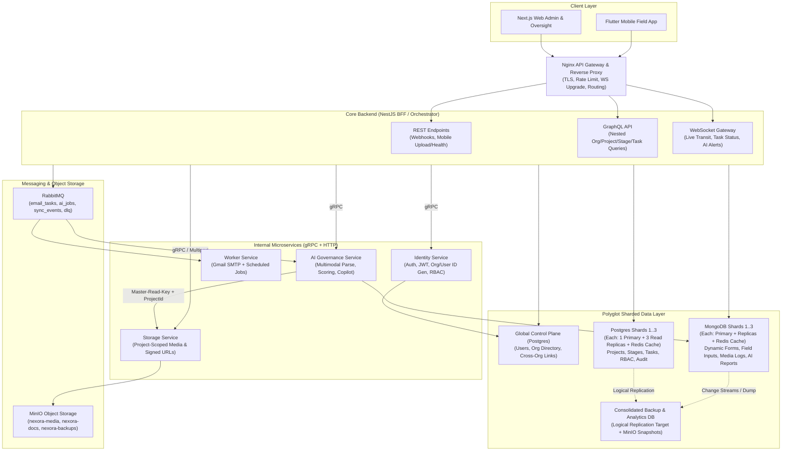
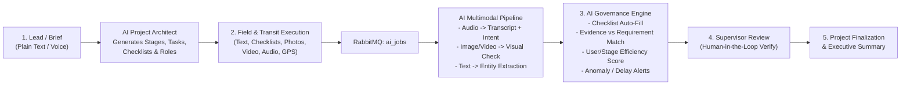

# Nexora Field OS

**A Configurable, Multi-Tenant, AI-Governed Platform for Distributed Field Operations Management**

Nexora Field OS is a configuration-first field operations platform designed for organizations with distributed workforces — solar EPC installers, construction contractors, logistics/transit teams, telecom rollouts, and facility management firms. Instead of hardcoding industry-specific workflows, Nexora treats operational processes (**projects, stages/milestones, tasks, dynamic checklists, custom schemas, and granular RBAC permission flags**) as runtime data, combined with **multimodal AI governance** for non-technical field teams.

---

## Table of Contents

1. [Core Capabilities](#1-core-capabilities)
2. [System Architecture & Topology](#2-system-architecture--topology)
3. [API Protocol Matrix (REST, GraphQL, gRPC, WebSockets)](#3-api-protocol-matrix)
4. [Organization ID Generation & 3-Shard Routing](#4-organization-id-generation--3-shard-routing)
5. [Polyglot Data Architecture, Replicas, Caching & Backups](#5-polyglot-data-architecture-replicas-caching--backups)
6. [Dynamic RBAC & Cross-Organization Collaboration](#6-dynamic-rbac--cross-organization-collaboration)
7. [Microservices & Infrastructure Contracts](#7-microservices--infrastructure-contracts)
8. [AI Support Governance & Multimodal Execution Flow](#8-ai-support-governance--multimodal-execution-flow)
9. [Target Repository Structure & Docker Profiles](#9-target-repository-structure--docker-profiles)
10. [Phased Implementation Roadmap](#10-phased-implementation-roadmap)

---

## 1. Core Capabilities

- **Multi-Tenant & Horizontally Sharded:** Organizations are isolated and deterministically routed across 3 database shards (`0–C`, `D–O`, `P–Z`) using their immutable unique ID segment, with a Global Control Plane for routing and cross-org discovery.
- **Polyglot Persistence:**
  - **PostgreSQL** for ACID relational integrity (orgs, users, dynamic RBAC flags, projects, stages, tasks, state transitions, media index, efficiency scores).
  - **MongoDB** for high-volume, polymorphic operational data (dynamic form schemas/submissions, field logs, transit GPS pings, audio transcripts, AI raw analyses).
- **Dynamic Custom Roles & Flags:** Organizations create custom roles (e.g., `Admin`, `Manager`, `Reporter`, `Volunteer`, `Site Engineer`) and toggle granular permission flags (e.g., create projects, manage all stages vs. manage allocated stages only, verify/approve only).
- **Cross-Organization Project Execution:** A host organization can invite partner organizations or external users onto specific project stages with least-privilege project-scoped roles.
- **AI Support Governance for Non-Technical Users:** From lead intake to final handover, AI converts plain-language briefs into structured project plans, parses field **text, images, videos, and audio voice notes** into checklist updates, monitors transit/on-field telemetry, and scores task efficiency and completion quality with human-in-the-loop sign-off.

---

## 2. System Architecture & Topology



---

## 3. API Protocol Matrix

Each protocol serves a strict, non-overlapping boundary to avoid duplicate endpoints and maintenance drift:

| Protocol | Boundary / Consumer | Responsibilities |
| :--- | :--- | :--- |
| **GraphQL** | Web Admin & Oversight Dashboard | Nested relational/operational queries (`Org → Project → Stage → Task → AssignedUsers → EfficiencyScore`) in a single round-trip without over-fetching. |
| **REST (HTTP/JSON)** | Public Auth, File Streaming, Mobile Field App, Webhooks | `identity-service` auth (`/register`, `/login`, `/verify`, `/reset`), `storage-service` multipart uploads & signed stream endpoints, lightweight mobile task execution, health probes. |
| **gRPC** | Internal Service-to-Service (`Backend ↔ Identity / Storage / AI`) | Strongly typed `.proto` contracts with low serialization latency over the internal Docker network (`VerifyToken`, `GetUserPermissions`, `ResolveOrgShard`, `MintSignedReadToken`, `AnalyzeArtifact`). |
| **WebSockets** | Web Dashboard & Mobile Field App | Real-time GPS/transit tracking, live task state transitions across cross-org teams, collaborator presence, and async AI completion/anomaly alerts. |

---

## 4. Organization ID Generation & 3-Shard Routing

### ID Format
```text
{ORG}-{YY}-{UNIQUEID}
Example: SOL-26-AX65T
```
- **`ORG`**: 3-letter uppercase prefix chosen by the Organization Admin (`^[A-Z]{3}$`).
- **`YY`**: 2-digit year of registration (e.g., `26` for 2026).
- **`UNIQUEID`**: 5-character cryptographically random Base-36 identifier (`[0-9A-Z]{5}`).

### Shard Routing Rule
Routing is computed strictly from the **first character of `UNIQUEID`** (`UNIQUEID[0]`)—**never** from the admin-chosen `ORG` initials—so data distributes evenly rather than clustering on common company starting letters:

| `UNIQUEID[0]` Range | Character Count | Target Shard | Approx. Distribution |
| :--- | :---: | :--- | :---: |
| **`0–9` and `A–C`** | 13 chars | **Shard 1** | ~36.1% |
| **`D–O`** | 12 chars | **Shard 2** | ~33.3% |
| **`P–Z`** | 11 chars | **Shard 3** | ~30.6% |

### Cross-Org Routing Resolution
1. `identity-service` guarantees global `org_id` uniqueness in the **Global Control Plane** (`org_directory`) and caches `org:route:{org_id}` in Redis.
2. When **Org A (Shard 1)** invites **Org B (Shard 3)** onto a Project, the Project and all of its Stages/Tasks remain on **Org A's shard (`owner_org_id` shard)**.
3. The Global Control Plane stores `project_collaborators (project_id, owner_org_id, partner_org_id, user_id, project_role_id)` so Org B users resolve directly to Shard 1 when opening the shared project.

---

## 5. Polyglot Data Architecture, Replicas, Caching & Backups

### 5.1 Database Ownership Split (Zero Duplicate Truth)

| Domain | PostgreSQL (ACID / Relational) | MongoDB (Polymorphic / High-Volume) |
| :--- | :--- | :--- |
| **Global Control Plane** | `users`, `org_directory`, `project_collaborators`, `refresh_tokens` | — |
| **Org & Dynamic RBAC** | `organizations`, `org_members`, `roles`, `role_permission_flags` | — |
| **Project Hierarchy** | `projects`, `stages`, `tasks`, `task_assignments`, `stage_dependencies`, `workflow_transitions` | `project_templates`, `stage_custom_schemas`, `task_checklists` |
| **Evidence & Execution** | `media_assets` (`file_id`, `project_id`, `stage_id`, `task_id`, `bucket`, `tags`) | `form_submissions`, `field_logs` (text, voice transcripts), `transit_events` (GPS breadcrumbs) |
| **AI Governance** | `task_efficiency_scores` (indexed KPIs for SQL sorting/analytics) | `ai_raw_analyses` (vision outputs, frame summaries, confidence/prompt traces) |

### 5.2 Shards, Read Replicas & Per-Shard Redis Cache
- **Read/Write Splitting:**
  - **Writes & Strong-Consistency Reads** (auth, RBAC flag checks, workflow state transitions) always hit the shard's **Primary** node.
  - **Read-Heavy Queries** (dashboards, lists, analytics, media metadata) load-balance across the shard's **3 Read Replicas** (with Primary fallback if replication lag affects read-your-own-writes).
- **Per-Shard Redis Cache:**
  - Namespaced strictly by shard and tenant: `s{shard_id}:{org_id}:{entity}:{id}` (e.g., `s1:SOL-26-AX65T:rbac:usr_42`).
  - **Explicit Invalidation:** Any role-flag update, collaborator invite, or task state change invalidates affected Redis keys synchronously on write.

### 5.3 Consolidated Backup Primary DB
- Because physical WAL streaming in PostgreSQL is 1-to-1 per cluster, Shards 1, 2, and 3 stream into **one Consolidated Backup & Analytics PostgreSQL Primary** via **PostgreSQL Logical Replication** (disjoint tenant rows prevent primary-key collisions).
- Scheduled `pg_dump` and `mongodump` snapshots are archived into the MinIO `nexora-backups` bucket.

---

## 6. Dynamic RBAC & Cross-Organization Collaboration

### Dynamic Role Flags
Organizations define custom roles (`Admin`, `Manager`, `Reporter`, `Volunteer`, `Supervisor`, etc.) and toggle scoped capability flags:
- **Organization Scope:** `org.manage_settings`, `org.manage_roles`, `org.invite_members`, `org.invite_partner_orgs`, `project.create`, `project.view_all`
- **Project & Stage Scope:** `project.manage`, `stage.manage_all`, `stage.manage_allocated_only`, `stage.view_only`
- **Task & Execution Scope:** `task.create_assign`, `task.execute_own`, `task.upload_evidence`, `task.verify_approve`, `task.override_deadline`
- **AI & Analytics Scope:** `ai.generate_plan`, `ai.view_efficiency_reports`, `ai.override_ai_flag`

### Cross-Organization Execution Model
1. Org A invites Org B (or specific Org B users) to **Project P** and binds them to a **Project-Specific Role** (e.g., `Transit Partner` limited to `Stage 2: Material Dispatch` with `stage.manage_allocated_only` and `task.upload_evidence`).
2. Org B's internal Org Admin privileges **never** leak into Org A's organization settings or unshared projects.
3. All stages, tasks, deadlines, and evidence remain auditable in one unified project timeline across participating organizations.

---

## 7. Microservices & Infrastructure Contracts

### 7.1 `minio-init.sh` (Bootstrap)
Executed as a one-shot initialization container once MinIO passes its health check:
- Creates private buckets: `nexora-media` (images, video, audio), `nexora-docs` (PDFs, checklists, invoices), `nexora-backups` (DB snapshots).
- Enforces private bucket policies (`mc anonymous set none`), generates least-privilege service-account credentials for `storage-service`, and applies lifecycle expiration rules on temporary upload chunks.

### 7.2 Storage Service (`storage-service`)
- **Upload (`POST /api/v1/storage/upload`):**
  - **Headers:** `x-master-storage-key`, `x-bucket-name`
  - **Body (multipart):** `file`, `projectId`, `orgId`, `stageId`, `taskId`, optional `tags`
  - **Behavior:** Validates the master storage key, stores object at `{orgId}/{projectId}/{stageId}/{uuid}-{filename}`, indexes metadata + tags, and returns `{ fileId, url, bucket, mimeType, size }`.
- **Authorized Read (`GET /api/v1/storage/files/:fileId`):**
  - **Internal Services (Backend / AI Worker):** Authenticate with `x-master-read-key` + `x-project-id` + file URL/ID; Storage Service verifies `file.projectId === x-project-id`.
  - **Web / Mobile Clients:** Never receive master keys. Backend validates the user's JWT + RBAC + `projectId` membership, then requests a **short-lived signed access URL/token** (bound to `fileId + projectId + userId + exp`) from Storage Service.

### 7.3 Worker Service (`worker-service`)
- Consumes RabbitMQ queues:
  - `email_tasks` — registration verification, org & cross-org invitations, task assignments, deadline alerts, stage verification notices.
  - `ai_analysis_tasks` — triggers asynchronous multimodal ingestion jobs.
  - `maintenance_tasks` — scheduled SLA checks and backup jobs.
- Sends transactional emails via **Gmail SMTP (Nodemailer)** + Handlebars templates behind an interchangeable `MailProvider` adapter, backed by a **Retry + Dead Letter Queue (`email_tasks.dlq`)**.

### 7.4 Identity Service (`identity-service`)
- Handles user registration, email verification, login, password reset, `userId` and `orgId` generation, and JWT issuance.
- Exposes **REST** publicly (via Nginx) and **gRPC** internally (`VerifyToken`, `GetUserPermissions`, `ResolveOrgShard`).

---

## 8. AI Support Governance & Multimodal Execution Flow

Designed for **non-technical field and operations teams** managing multiple concurrent projects from initial lead to final sign-off:



1. **Lead-to-Structure Generator:** Admin enters a plain-language brief → AI proposes stages, tasks, checklists, role allocations, and deadlines for one-click approval.
2. **Multimodal Field Input Parsing:** Workers submit voice notes (audio), photos, short site/transit videos, or brief text notes → AI transcribes, translates, inspects visual evidence (cargo condition, PPE, installation completion), and auto-fills task checklists with confidence scores.
3. **Transit & On-Field Governance:** Correlates GPS check-in/out events, transit timestamps, and uploaded evidence to detect stalled stages, overdue deadlines, or missing proof.
4. **Task Efficiency & Completion Scoring:** Computes per-user and per-stage KPIs (timeliness vs. deadline, evidence completeness %, rework/rejection rate) across all active projects.
5. **Human-in-the-Loop Guardrail:** AI recommends transitions and flags missing evidence; human supervisors/verifiers retain final approval authority.

---

## 9. Target Repository Structure & Docker Profiles

```text
Nexora-Field-OS/
├── apps/
│   ├── web/                     # Next.js (TypeScript + Tailwind) Admin & Oversight App
│   └── mobile/                  # Flutter Field & Transit Execution App
├── services/
│   ├── api-gateway/             # NestJS Orchestrator (GraphQL, REST, WebSocket Gateway)
│   ├── identity/                # Identity & Org/Shard Directory Service (REST + gRPC)
│   ├── storage/                 # Project-Scoped MinIO Storage Service
│   ├── worker/                  # RabbitMQ Consumer + Gmail SMTP Mailer + Cron
│   └── ai-governance/           # Multimodal AI Pipeline & Efficiency Scoring (gRPC + RMQ)
├── packages/
│   ├── proto/                   # Shared gRPC .proto definitions
│   └── shared-types/            # Shared TS interfaces, RBAC flag constants, ID validators
├── infra/
│   ├── nginx/                   # Reverse proxy, TLS, WebSocket upgrade, rate limiting
│   ├── minio/minio-init.sh      # Bucket bootstrap, private policies, lifecycle rules
│   ├── postgres/                # Global Control Plane, Shard init, Logical Replication setup
│   └── mongodb/                 # Shard & replica set bootstrap scripts
├── docker-compose.yml           # Profiled: `dev` (lightweight) & `cluster` (3 shards × 3 replicas)
└── README.md
```

### Docker Compose Profiles
- **`dev` profile (Default Local Development):** Runs 1 logical PostgreSQL shard + 1 replica, 1 MongoDB instance, 1 Redis instance, MinIO, RabbitMQ, Nginx, and all microservices while keeping full shard-routing code active.
- **`cluster` profile (Full Distributed Topology):** Spins up all 3 PostgreSQL shards (each with 1 Primary + 3 Read Replicas), 3 MongoDB shards, per-shard Redis caches, and the Consolidated Logical-Replication Backup Primary.

---

## 10. Phased Implementation Roadmap

| Phase | Milestone | Key Deliverables |
| :--- | :--- | :--- |
| **Phase 0** | Infrastructure & Monorepo | Monorepo scaffold, `docker-compose.yml` (`dev` + `cluster` profiles), `minio-init.sh`, Nginx, RabbitMQ |
| **Phase 1** | Identity, Sharding & RBAC | `identity-service`, `{ORG}-{YY}-{UNIQUEID}` + `0-C / D-O / P-Z` router, Read/Write splitter, per-shard Redis, dynamic RBAC flags |
| **Phase 2** | Project & Cross-Org Engine | Postgres + Mongo repositories (`Project → Stage → Task`), GraphQL + REST APIs, `project_collaborators`, WebSocket gateway |
| **Phase 3** | Storage & Worker Services | `storage-service` (master keys + signed client URLs + tags), `worker-service` (RabbitMQ + Gmail SMTP + DLQ) |
| **Phase 4** | Web & Mobile Apps | Next.js multi-project dashboard + dynamic role/stage builders; Flutter mobile execution app (GPS, camera/video/audio, offline draft queue) |
| **Phase 5** | AI Support Governance | `ai-governance` service: Lead-to-Plan generator, multimodal audio/image/video/text parser, efficiency scoring & anomaly alerts |
| **Phase 6** | Cluster Hardening & Demo | Full `cluster` profile validation, logical-replication backup/restore test, cross-tenant security audit, multi-org end-to-end demo |
