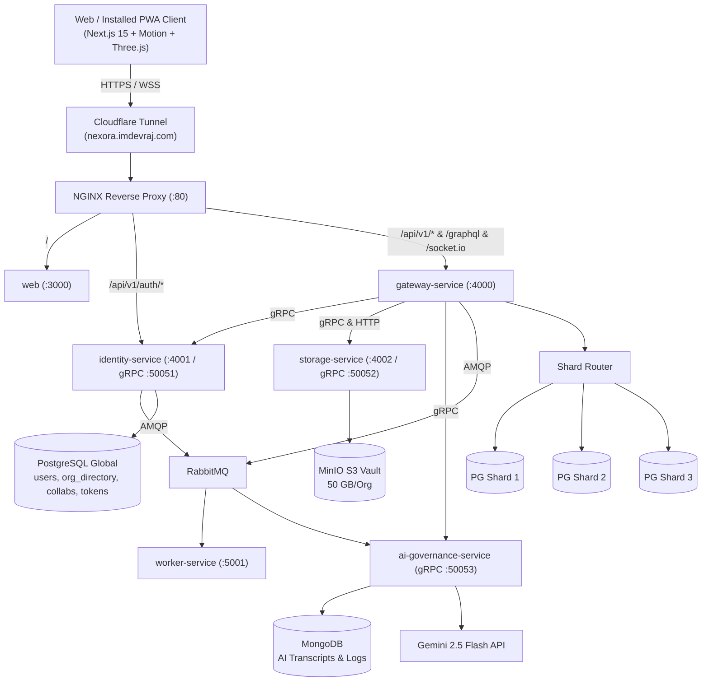
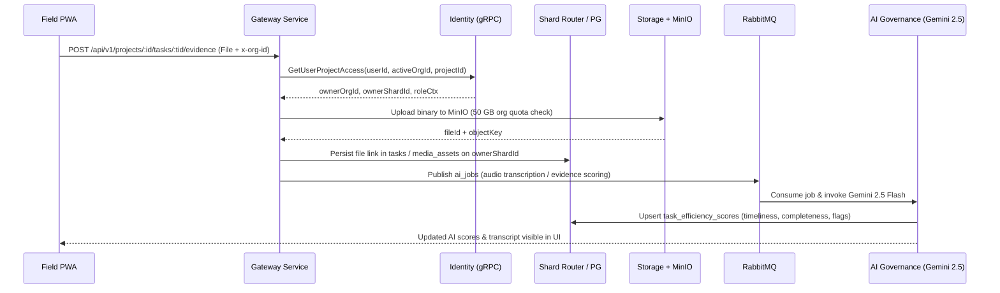
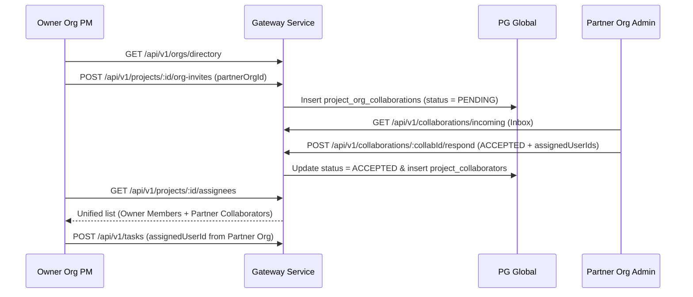

# NEXORA FIELD OS — Complete Project Master Specification (Tech, Business, Architecture & Flows)

> **Purpose of this Document:** This is a comprehensive, single-source-of-truth specification for **Nexora Field OS**. It is designed to be fed directly to any AI agent to generate academic project reports, investor pitch decks, technical documentation, or system design presentations.

---

## 1. Executive Summary & Identity
- **Project Name:** Nexora Field OS
- **Category:** Multi-Tenant, Horizontally Sharded, AI-Governed Field Operations & Execution Operating System
- **Delivery Form:** Responsive Web Application + Installable Progressive Web App (PWA) for Mobile & Tablet (no native APK required)
- **Live Domain:** `https://nexora.imdevraj.com` (proxied via Cloudflare Tunnel + NGINX)
- **Target Industries:** Construction, Solar & Renewable Energy, Telecom Infrastructure Rollout, Field Logistics, Civil/Electrical Audits, Multi-Vendor Site Operations.

---

## 2. Business Lens: Pain Points, Solution & USPs

### 2.1 Industry Pain Points Solved
1. **Rigid, Hardcoded Workflows:** Desk-oriented tools (Jira/Trello/Asana) force every department into static status columns, failing to match real civil, electrical, procurement, and commissioning lifecycles.
2. **Unverified Proof of Work:** Photos, videos, and site updates shared over WhatsApp lack structured task binding, geotag/timestamp context, and searchable archival.
3. **Language & Field-Entry Friction:** Field technicians on-site prefer speaking in Hindi, Hinglish, or regional dialects rather than typing lengthy English forms on small screens.
4. **Cross-Organization Silos:** Prime contractors and external partner vendors cannot collaborate on shared project milestones or assign tasks across org boundaries without exposing unrelated tenant data.
5. **Disconnected Project Finance:** Project budgets, vendor purchase orders, and technician reimbursement claims sit in separate Excel sheets detached from task execution and invoice proofs.
6. **Session Dropouts on Mobile:** Short-lived auth tokens cause 401 errors when reloading media or submitting evidence mid-shift.

### 2.2 Unique Selling Propositions (USPs)
1. **Zero Hardcoded Workflows:** Organization admins configure default statuses, and Project Managers customize **project-scoped Kanban columns** and **editable milestones** per project.
2. **9-Type Proof-Gated Checklists:** Tasks support `CHECK`, `TEXT`, `NUMBER` (with units), `FILL_BLANK`, `SHORT_ANSWER`, `OPTIONS` (single-select), `MULTI_SELECT`, `FILE`, `MEDIA`, and `LINK`, plus custom-named **multi-slot file submission headers**. Tasks cannot transition to `DONE`/`COMPLETED`/`SUBMITTED`/`VERIFIED` until all required items are satisfied.
3. **50 GB Tenant-Isolated MinIO Media Vault:** Dedicated S3-compatible bucket prefixes per organization, searchable Media Directory (`/evidence`) with project/type filters, 10-minute HMAC signed URLs, and **archived-project deletion protection** (Admins can delete media only while the project is not `ARCHIVED`).
4. **Mixed-Language Voice AI Governance:** Technicians record field audio notes directly in the PWA; **Gemini 2.5 Flash** transcribes Hindi/English/Hinglish/regional audio, computes timeliness & evidence completeness scores, and flags project risks.
5. **Cross-Organization Federation:** Prime organizations invite partner organizations (`PENDING` → `ACCEPTED`), partner orgs assign their own specialists while or after accepting, and Project Managers assign tasks seamlessly across both owner and partner users.
6. **Integrated Budgets & Reimbursements:** Track project budgets, revisions, vendor expenses (with MinIO receipts), and technician reimbursement claims (`PENDING` → `APPROVED`/`REJECTED` → `PAID`) in one ledger.
7. **PWA-First Field Ergonomics:** Installable web app with a **5-button bottom dock** (`Overview`, `Tasks`, `Projects`, `Media`, `Finance`), `safe-area-inset` support, Light/Dark isolated surfaces, and automatic background JWT refresh.

---

## 3. Complete Feature Matrix

| Module | Key Capabilities |
| :--- | :--- |
| **Authentication & RBAC** | Multi-org onboarding, email OTP verification, invite links, `2h` JWT access tokens + rotating `7d` refresh tokens (`POST /api/v1/auth/refresh`), global `401` auto-retry interceptor, granular `PERMISSION_FLAGS` RBAC. |
| **Projects & AI Lead-to-Plan** | Project creation with rich lead blueprints, AI Lead-to-Plan stage generation, custom per-project Kanban statuses, editable/reorderable milestones (`stages`), Project Manager assignment. |
| **Task Execution & Checklists** | Milestone-bound task creation, drag-and-drop Kanban board, slide-over `TaskDetailDrawer`, mobile `/tasks/[taskId]` execution view, 9 checklist input types, multi-slot file requirements. |
| **Cross-Org Collaboration** | Partner org directory (`GET /api/v1/orgs/directory`), org collaboration invites (`POST /projects/:id/org-invites`), inbox accept/decline + team assignment (`POST /collaborations/:collabId/respond`), unified cross-org task assignees (`GET /projects/:id/assignees`). |
| **Media Directory (MinIO)** | 50 GB org quota tracking, filter by project & media type (`IMAGE`, `VIDEO`, `AUDIO`, `DOCUMENT`), signed-URL preview, AI voice transcripts, delete lock when project is `ARCHIVED`. |
| **AI Governance** | On-demand project progress synthesis (`POST /projects/:id/analyze-ai`), task efficiency scoring (`timeliness_score`, `evidence_completeness`, `overall_efficiency`, `ai_risk_flags`), voice transcription via RabbitMQ `ai_jobs`. |
| **Finance & Reimbursements** | Project budget allocation & revision history, vendor expense logging with MinIO receipt upload, reimbursement claim submission & manager review (`APPROVED`/`REJECTED`/`PAID`). |
| **Calendar, Inbox & Activity** | Interactive 7-column monthly calendar (`/calendar`) with task pills & daily agenda, Verification/SLA/Collaboration Inbox (`/inbox`), real-time activity feed (`/activity`), Socket.IO live updates. |

---

## 4. Technical Architecture & Infrastructure

### 4.1 Technology Stack
- **Frontend & PWA:** Next.js 15 (App Router, React 19), Tailwind CSS v4, Zustand (persisted `useAuthStore`, `useThemeStore`, `useDrawerStore`), Framer Motion (`motion/react`), GSAP + ScrollTrigger, Three.js / React Three Fiber (`NebulaParticleHero`).
- **Typography & Theme System:** Rounded geometric sans-serif (`Outfit` + `Plus Jakarta Sans`), Light (`#eef0f4`) & Dark (`#07080c`) modes, isolated `[data-surface="dark"]` & `[data-surface="light"]` CSS rules.
- **Microservices (Node.js 22 + TypeScript):**
  - `identity-service` (`:4001` HTTP, `:50051` gRPC)
  - `gateway-service` (`:4000` HTTP/REST/GraphQL/Socket.IO)
  - `storage-service` (`:4002` HTTP, `:50052` gRPC)
  - `ai-governance-service` (`:50053` gRPC + RabbitMQ `ai_jobs` consumer)
  - `worker-service` (`:5001` HTTP + RabbitMQ `email_tasks` consumer)
- **Data & Storage Layer:**
  - **PostgreSQL 16:** `nexora_global` (auth, org directory, collaborations, refresh tokens) + 3 operational shards (`nexora_s1`, `nexora_s2`, `nexora_s3`) routed via `@nexora/shard-router`.
  - **MongoDB:** Unstructured AI transcripts, progress reports, and governance logs.
  - **MinIO (S3):** `nexora-media` and `nexora-docs` buckets with 50 GB/org quota.
  - **Redis & RabbitMQ:** Ephemeral caching and asynchronous event/AI/email queues.
- **Edge & Deployment:** Docker Compose (13 containers), NGINX reverse proxy (`:8080` -> `:80`), dual Cloudflare Tunnels (`nexora-apps` container for `https://nexora.imdevraj.com` + `dev-host-ssh` systemd service for `ssh.imdevraj.com`).

### 4.2 High-Level System Architecture Diagram

---

## 5. System Flows (User Flow, Data Flow & Cross-Org Flow)

### 5.1 End-to-End User Flow

```mermaid
flowchart LR
    U1["1. Register Org / Login<br/>(2h JWT + 7d Refresh)"] --> U2["2. Create Project &<br/>AI Lead-to-Plan Blueprint"]
    U2 --> U3["3. Add Milestones &<br/>Custom Kanban Statuses"]
    U3 --> U4["4. Invite Partner Org<br/>(Pending -> Accepted)"]
    U4 --> U5["5. Assign Tasks Across<br/>Owner & Partner Users"]
    U5 --> U6["6. Field Execution (PWA)<br/>9-Type Checklists + Voice Note"]
    U6 --> U7["7. MinIO Proof Upload &<br/>Gemini 2.5 AI Scoring"]
    U7 --> U8["8. QA Verification &<br/>Budget / Claim Settlement"]
```

### 5.2 Evidence, Voice AI & Shard Data Flow

### 5.3 Cross-Organization Collaboration Flow

---

## 6. Database Schema Overview
- **Global Database (`nexora_global`):**
  - `users`: Global user identities (`user_id`, `email`, `password_hash`, `full_name`, `is_verified`).
  - `org_directory`: Maps `org_id` → `shard_id` (`1`, `2`, `3`) and `org_name`.
  - `user_org_memberships`: Maps users to organizations and roles.
  - `refresh_tokens`: Hashed `7d` refresh tokens supporting rotation and revocation.
  - `org_invitations`: Tokenized member onboarding invitations.
  - `project_org_collaborations`: Cross-org project invitations (`PENDING`, `ACCEPTED`, `REJECTED`).
  - `project_collaborators`: Individual partner users assigned to a project with `allocated_stage_ids` and `permission_flags`.
- **Operational Shards (`nexora_s1`, `nexora_s2`, `nexora_s3`):**
  - `organizations`, `roles`, `org_member_roles`, `org_members`
  - `projects` (`workflow_statuses`, `lead_brief`, `manager_user_id`, `status`)
  - `stages` (project milestones with `order_index` and `deadline`)
  - `tasks` (`checklist` JSONB supporting 9 input kinds, `file_requirements` JSONB, `assigned_user_id`, `status`)
  - `media_assets`, `task_efficiency_scores`, `workflow_transitions`
  - `project_budgets`, `budget_revisions`, `expenses`, `reimbursement_claims`

---

## 7. Implementation Roadmap & Key Engineering Decisions
1. **Authentication Resilience:** Switched from `15m` unrefreshed tokens to `2h` access tokens + rotating `7d` refresh tokens (`POST /api/v1/auth/refresh`) and installed a global `window.fetch` interceptor in `apps/web/src/services/nexoraClient.ts` so expired sessions auto-recover without failing storage/evidence reloads.
2. **Checklist Enforcement:** `ProjectService` validates type-specific completion before allowing status transitions into `DONE`-category columns (numeric check for `NUMBER`, non-empty text for `FILL_BLANK`/`SHORT_ANSWER`/`TEXT`, selected option(s) for `OPTIONS`/`MULTI_SELECT`, uploaded `fileId` for `FILE`/`MEDIA`).
3. **Media Protection:** `ProjectService.deleteFile` checks `projects.status` on the owner shard and blocks deletion (`403`) whenever `status === 'ARCHIVED'`.
4. **Milestone-Driven Task Creation:** `TaskCreateModal` dynamically binds tasks to the project's created `stages` (milestones) and populates assignees from `GET /api/v1/projects/:id/assignees`.
5. **Dual Cloudflare Tunnel Networking:** `nexora-cloudflared` (Docker `edge-net`) routes `https://nexora.imdevraj.com` → `http://nginx:80`, while `cloudflared-ssh.service` (host systemd user service) routes `ssh.imdevraj.com` → `ssh://localhost:22`.

---

## 8. Instructions for Any AI Agent Generating a Report from This File
When using this specification to write an academic report, pitch deck, or documentation:
1. Keep every architectural claim grounded in the services, schemas, routes, and metrics documented above.
2. Emphasize both **Business Value** (solving field fragmentation, WhatsApp chaos, language barriers, and disconnected finance) and **Technical Depth** (PostgreSQL horizontal sharding, gRPC/RabbitMQ microservices, MinIO 50 GB isolation, Gemini 2.5 AI governance, and rotating JWT auth).
3. Include the Mermaid diagrams from Section 4 & Section 5 for System Architecture, User Flow, Evidence/AI Data Flow, and Cross-Org Collaboration.
